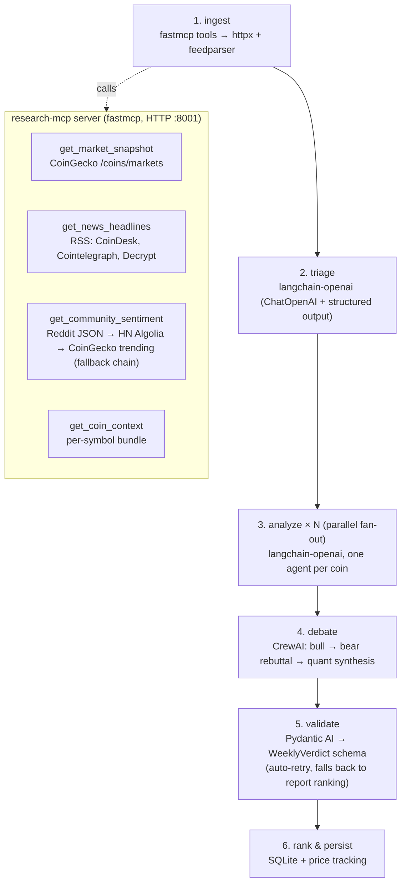

# crypto_fundamental_analyst

An agentic fundamental analyst for cryptocurrency — weekly picks elected by a local LLM pipeline.

No API keys, no paid services. Data comes from public endpoints (CoinGecko, RSS feeds, community posts) and all the "thinking" goes through your own vLLM server. One run per week ranks a handful of coins worth watching, saves the picks, and tracks how last week's picks actually performed. Small web UI included.

## How it works

Three frameworks, three jobs — glued together by LangGraph:

- **LangGraph** owns the pipeline (state, control flow, parallel fan-out)
- **CrewAI** does the debate step only: a bull, a bear and a quant discuss the shortlist
- **Pydantic AI** is the gatekeeper: converts the crew's free-text consensus into a strict typed verdict, retrying on schema violations
- **fastmcp** powers a small MCP server (`research-mcp`) — the only place in the system that touches the internet

All three frameworks talk to the same vLLM endpoint (OpenAI-compatible). "Different models" in the debate = different personas, not different LLMs.

## Workflow schema



Everything downstream of ingest reads pre-fetched evidence — the analyst agents never browse. Fetchers are hard-budgeted: ≤30 items per source, ~1500 chars per item, 15s timeout, one attempt, results cached for 6h. A dead source degrades to an empty bundle instead of killing the run.

A run costs roughly: 1 triage call + N parallel coin analyses (N≈8) + 3 debate calls + 1 validation call. A few minutes on a single consumer GPU.

## Layout

```
app/
  main.py            FastAPI + weekly cron scheduler (Mon 06:00 by default)
  mcp_server/        research-mcp: tool defs + budgeted fetchers
  graph/
    pipeline.py      LangGraph state machine
    nodes.py         ingest / triage / per-coin analysis
    debate.py        CrewAI debate crew
    validator.py     Pydantic AI verdict validator
  db.py              SQLite: runs, picks, return% tracking
web/index.html       minimal UI (picks, rationale, run button, history)
docker-compose.yml   mcp + app (vLLM optional, see below)
```

## Setup

Prereqs: Docker, and a vLLM server serving an instruct model that supports tool calling (tested with Qwen3-4B-AWQ on an RTX 3060 Ti 8GB).

1. vLLM outside Docker is the default setup (it's the heaviest piece, and you may already run it in WSL):

   ```bash
   python -m vllm.entrypoints.openai.api_server \
     --host 0.0.0.0 --port 8002 \
     --model /path/to/Qwen3-4B-AWQ \
     --served-model-name Qwen3-4B \
     --quantization awq --max-model-len 16384 \
     --gpu-memory-utilization 0.80 --enforce-eager \
     --enable-auto-tool-choice --tool-call-parser hermes
   ```

   The last two flags matter — structured output in the pipeline needs them.

2. Configure and start:

   ```bash
   cp .env.example .env   # VLLM_BASE_URL + MODEL_NAME must match your vLLM
   docker compose build
   docker compose up -d
   ```

   (If PyPI is unreliable on your network, the Dockerfile already resolves from the TUNA mirror.)

3. Open http://localhost:8000 → **Run now**. Weekly runs happen automatically (Monday 06:00, configurable in `.env`).

A fully dockerized vLLM also exists as an optional profile: `docker compose --profile docker-gpu up -d vllm`.

## Notes / gotchas

- Reddit and Google-fronted services (e.g. HN Algolia) are blocked from some networks; the sentiment tool falls back automatically (Reddit → HN → CoinGecko trending).
- A run that happens while vLLM is down is recorded as `failed` — restart vLLM and run again, nothing else breaks.
- Past picks get `return_pct` filled in on the next weekly run — a free, naive backtest.
- To reuse the MCP tools elsewhere (any MCP client), point it at `http://localhost:8001/mcp`.

## Stack

Python 3.11 · LangGraph · CrewAI · Pydantic AI · fastmcp · FastAPI · httpx/feedparser · APScheduler · SQLite · vLLM · Docker Compose
